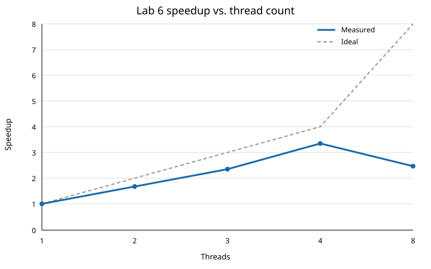

# Lab 6: Multithreaded Grayscale and Sobel Pipeline

## Implementation and measurement method

`lab6.cpp` retains the optimized algorithms from Lab 5:

- Grayscale: fixed-point BT.709, `Y = (74B + 732G + 218R + 512) >> 10`
- Sobel: 3x3 Sobel `Gx`/`Gy` with `min(|Gx| + |Gy|, 255)` magnitude
- Borders: skipped, so the edge image is `(W-2) x (H-2)`

The program is built with `make lab6`, which uses `-O3` and leaves automatic
compiler vectorization enabled. It uses `std::thread` and links with `-pthread`.
`cv::setNumThreads(1)` is set so OpenCV does not introduce extra application
worker threads.

**Host used for these results:** Intel Core Ultra 9 288V (8 cores, no SMT),
Ubuntu 26.04.1, g++ 15.2.0, OpenCV 4.10.0. This is not a Raspberry Pi, so the
numbers below are development-host results. The executable must be rerun on
the target Pi before submitting Pi-specific performance results.

For the Part 3 comparison, the process was pinned to CPU IDs 0--3 with
`taskset -c 0-3`. Every configuration, including the original baseline, used
that same four-CPU affinity. This makes the eight-worker configuration a real
oversubscription test, but it does not make this Intel host equivalent to a Pi.

**Input:** the first 30 frames of `bbb_sunflower_2160p_60fps_normal.mp4`,
3840x2160.

**Timing:** frames are decoded before timing; grayscale/output Mats and each
fused worker's private scratch buffer are allocated before timing. One warm-up
pass is followed by seven timed repetitions. Results are reported in
milliseconds per frame. The median is the main value because it is the
methodology used in the prior lab; the arithmetic mean is also shown because
the prompt uses the word “average.” Decode, allocation, display, file output,
and correctness checks are excluded. Thread creation and joining are included
in threaded timings so their overhead is visible.

Reproduce the run with:

```sh
make lab6
# On this 8-core development host, constrain all configurations to four CPUs:
taskset -c 0-3 ./lab6 /path/to/bbb_sunflower_2160p_60fps_normal.mp4 30 7 1,2,3,4,8
# On a four-core Raspberry Pi, run the same lab6 command without taskset.
# Append --write-artifacts to export the PNG correctness evidence and SVG graph.
```

## Part 1: single-threaded baseline

| Stage | Median (ms/frame) | Arithmetic mean (ms/frame) |
|---|---:|---:|
| Grayscale conversion | 6.696 | 6.732 |
| Sobel edge detection | 14.626 | 14.633 |
| Complete grayscale + Sobel pipeline | 21.609 | 21.580 |

The separate grayscale and Sobel medians are intentionally measured in
separate timed regions, so they need not add exactly to the directly measured
pipeline median.

### Part 1 answers

1. The directly measured complete pipeline took **21.609 ms/frame** (median;
   21.580 ms/frame arithmetic mean). The individual stage medians were
   **6.696 ms/frame** for grayscale and **14.626 ms/frame** for Sobel.
2. **Sobel** is the largest operation. Its standalone median is about 67.7% of
   the complete-pipeline median (`14.626 / 21.609`).
3. With perfectly parallel work and no overhead, four cores would provide a
   **4.00x speedup**: grayscale would take about **1.674 ms/frame**, Sobel about
   **3.657 ms/frame**, and the complete pipeline about **5.402 ms/frame**.
   This is an ideal lower bound, not an expected real measurement.

If the rubric requires the arithmetic mean rather than the prior lab's median,
use **6.732 ms/frame** (grayscale), **14.633 ms/frame** (Sobel), and
**21.580 ms/frame** (pipeline); the corresponding ideal four-core pipeline
time is **5.395 ms/frame**. Sobel remains the dominant stage.

## Part 2: multithreaded pipeline

### Work partitioning and halo rows

The output has `H-2` Sobel rows. For `T` workers, it is split into contiguous,
balanced half-open ranges:

```text
worker i: [ floor(i*(H-2)/T), floor((i+1)*(H-2)/T) )
```

Each worker owns only its output rows, so no two threads write the same output
byte. The color input is read-only. The challenge is that output row `y` needs
grayscale rows `y`, `y+1`, and `y+2`.

`lab6` implements two safe approaches:

- **Phased pipeline:** each worker first generates a disjoint range of a
  shared full grayscale Mat. A barrier waits until all grayscale rows are
  ready; workers then run Sobel on their output bands. This avoids duplicated
  grayscale work but requires a global synchronization point.
- **Fused redundant pipeline (the Part 2 implementation):** a worker assigned
  output rows `[a, b)` owns a private, preallocated three-row grayscale window.
  It converts color rows `a` through `b+1`, computes only edge rows `[a, b)`,
  and writes them directly to the global edge Mat. Neighboring bands recompute
  the two halo grayscale rows at their boundary. This removes the inter-stage
  barrier entirely while ensuring each thread performs both grayscale and
  Sobel work for its own band.

At four workers, the fused design redundantly converts six grayscale rows
(two rows at each of three boundaries), only about 0.28% of a 2160-row frame.
Each active worker needs only `3W` bytes of private grayscale scratch space:
11.25 KiB at 3840 pixels wide, or 45 KiB for four workers. That small amount
of extra work and scratch memory is the tradeoff for independent workers.

## Correctness validation

Before timing, the program compares every threaded result byte-for-byte with
the serial reference for one source frame. It calculates maximum absolute
pixel difference, total differing pixels, and differences in output rows
within one row of a thread boundary. It verifies parallel grayscale, parallel
Sobel, phased pipeline, and fused pipeline at 1, 2, 3, 4, and 8 workers. The
same checks run on:

- the original contiguous video frame;
- a padded, non-contiguous OpenCV ROI, which confirms row strides are honored;
- a random 7x9 image, which forces uneven row bands.

All checks passed. The fused four-worker results were:

| Comparison | Maximum absolute pixel difference | Differing pixels | Differences near thread boundaries |
|---|---:|---:|---|
| Serial vs. fused, 3840x2160 source frame | 0 | 0 of 8,282,404 | No (0) |
| Serial vs. fused, padded non-contiguous 3840x2160 ROI | 0 | 0 of 8,282,404 | No (0) |
| Serial vs. fused, uneven 7x9 input | 0 | 0 of 35 | No (0) |

No synchronization is needed for final edge stores because each worker has
exclusive ownership of its output rows. `join()` only ensures the complete
frame is ready before it is reused.

### Part 2 answers

1. The program splits the `H-2` Sobel output rows into balanced contiguous
   half-open ranges using the formula above. The integer floor formula
   distributes any extra rows among the bands, so heights not divisible by the
   worker count are handled without gaps or overlapping edge writes.
2. A fused worker keeps a rotating private window of three grayscale rows. For
   its output band `[a, b)`, it converts color rows `a` through `b+1`; the two
   rows shared with the neighboring band are intentionally recomputed as halo
   rows.
3. The fused implementation requires **no barrier while processing an image**.
   It reads immutable color input and writes a disjoint output-row range. The
   threads synchronize only when the caller joins them after the frame. The
   optional phased comparison implementation does require a barrier between
   grayscale and Sobel.
4. The fused approach adds `3W` bytes of scratch per active worker and two
   redundant grayscale rows at each partition boundary. With four 4K workers,
   that is 45 KiB of active scratch and six redundant grayscale-row conversions.
   It also includes normal thread creation/join overhead, which this benchmark
   deliberately measures.
5. The program compares byte values against the serial output for 1, 2, 3, 4,
   and 8 workers,
   a normal frame, a non-contiguous ROI, and an uneven 7x9 image. It reports
   maximum absolute difference, differing-pixel count, and boundary-adjacent
   differences. Every comparison was bit-identical: maximum difference 0 and
   zero differing pixels.

## Part 3: thread scaling

The following table is the required complete-pipeline measurement. It uses the
fused Part 2 pipeline, the same 30 preloaded 4K frames, one warm-up, and seven
timed repetitions for every row. The total includes thread creation, joining,
row partitioning, and halo-row work, but not video decode or display.

Speedup is `S(N) = T_baseline / T_N`; efficiency is `E(N) = S(N) / N`.

| Threads | Total time (ms/frame) | Speedup | Parallel efficiency |
|---|---:|---:|---:|
| Original single-threaded | 21.609 | 1.000x | — |
| 1 | 21.544 | 1.003x | 100.3% |
| 2 | 12.928 | 1.671x | 83.5% |
| 3 | 9.169 | 2.357x | 78.6% |
| 4 | 6.470 | 3.340x | 83.5% |
| 8 | 8.758 | 2.467x | 30.8% |

### Part 3 answers

1. Execution time drops substantially from one through four workers: 21.544,
   12.928, 9.169, and 6.470 ms/frame. At eight workers it rises to 8.758
   ms/frame, so adding workers past the four available CPUs hurts performance.
2. **Four workers** achieve the best result: **6.470 ms/frame**, a **3.340x**
   speedup over the original single-threaded baseline.
3. Scaling is not proportional. Perfect four-worker scaling would be 4.00x,
   but the measured speedup is 3.340x. Eight workers are not 8x faster; they
   are slower than four workers and provide only 2.467x baseline speedup.
4. The one-worker fused pipeline is 21.544 ms/frame, effectively the same as
   the 21.609 ms/frame original full-frame serial baseline (0.3% faster). It
   creates no OS worker at a count of one, so this small difference is ordinary
   timing variation and the fused three-row dataflow, not parallel work.
5. With four CPUs available, eight workers oversubscribe the machine. The OS
   must time-slice them, and cache locality worsens; the measured time grows
   35.4% from 6.470 ms/frame at four workers to 8.758 ms/frame at eight.
6. Scalability is limited by thread creation/joining per frame, memory-bandwidth
   and cache contention, scheduling/load imbalance, the small halo-row
   recomputation cost, and CPU-frequency/operating-system variation. The fused
   version avoids a grayscale-to-Sobel barrier, but it cannot remove those
   costs.

The fused design shows why a small amount of redundant computation can be
useful: it replaces a dependency on neighboring workers' grayscale rows with
private local data. It retains exactly the same pixel values while allowing
each worker to execute its grayscale and Sobel work as one independent band.

## Part 4: thread management and performance overhead

This implementation uses **Approach A: create threads for each frame**. Every
call to `fusedPipeline` invokes `runRowWorkers`, creates the requested
`std::thread` objects, assigns each a row band, and joins them before the next
frame starts. The one-worker case is a special case: it calls the same fused
row-band code directly and does not create an OS thread.

The benchmark deliberately includes this management cost. It excludes video
decode and all `cv::Mat`/private-scratch allocation, so those do not obscure
the per-frame threading cost.

### Part 4 answers

1. The program creates a new set of worker threads **for every frame** and
   joins them before processing the next frame. It does not use a persistent
   worker pool.
2. Each multithreaded frame pays for `std::thread` construction, kernel thread
   startup and scheduling, creation of the small `std::vector<std::thread>`,
   row-range assignment, joining, and cache-coherence/memory-system traffic.
   The fused implementation has no grayscale-to-Sobel barrier, but joining is
   still required at the end of every frame. The grayscale scratch Mats are
   preallocated, so they are not part of the timed management overhead.
3. Thread startup and joining are approximately fixed costs per frame, while
   grayscale/Sobel work shrinks with the pixel count. On a small image, there
   may not be enough useful work to amortize those fixed costs, so one worker
   can equal or beat several workers. This effect is much smaller for the 4K
   measurements because each worker has many output rows to process.
4. More threads can increase time when they exceed the available cores, causing
   time-slicing and context switches. Even at or below the core count, workers
   can contend for cache capacity and memory bandwidth, incur scheduling/join
   overhead, receive uneven bands, and lose frequency headroom. The Part 3
   result demonstrates this directly: eight workers on four allowed CPUs took
   8.758 ms/frame, versus 6.470 ms/frame for four workers.
5. On a true eight-core processor, eight workers could use additional cores and
   would likely improve on the four-worker result, unlike the intentionally
   oversubscribed four-CPU experiment. It would not necessarily be twice as
   fast: memory bandwidth, cache sharing, per-frame thread creation, core
   performance differences, and operating-system scheduling still limit
   scaling. A target eight-core system must be measured separately.

**Approach B tradeoff:** a persistent pool would create the workers once, then
dispatch one row-band job per worker for each frame and wait for completion.
That amortizes creation/destruction and can help especially at small image
sizes or high frame rates. It requires more code and coordination: a job queue
or shared frame state, a condition variable/barrier, a completion counter, and
a clean shutdown protocol. It removes startup cost, not memory-bandwidth or
cache-contention limits.

## Part 5: overall performance analysis

| Metric | Original single-threaded | Best multithreaded | Speedup |
|---|---:|---:|---:|
| Grayscale + Sobel (ms/frame) | 21.609 | 6.470 (4 fused workers) | 3.340x |

The four-worker fused pipeline reduces complete-pipeline time by 70.1%, from
21.609 to 6.470 ms/frame. It reaches 83.5% of ideal four-core scaling
(`3.340 / 4`); ideal scaling would have been 5.402 ms/frame, so 1.068 ms/frame
remains as parallel overhead and imperfect scaling.

### Part 5 answers

1. The maximum measured speedup is **3.340x**, using four fused workers.
2. The result reaches **83.5% parallel efficiency** on four allowed CPUs. It
   is close to, but below, ideal 4.00x scaling because the measured time is
   6.470 ms/frame rather than the ideal 5.402 ms/frame.
3. The most likely primary bottleneck is aggregate memory/cache pressure while
   several workers stream color input and write output, combined with the
   per-frame creation/join cost. The fused design removes the inter-stage
   dependency barrier, yet scaling remains sublinear and eight workers slow
   down, which is consistent with resource contention rather than a Sobel
   correctness dependency.
4. For this 4K workload, the complexity is justified when throughput matters:
   it saves 15.139 ms/frame and produces bit-identical output. The tradeoff is
   less compelling for small images, where fixed thread-management overhead
   can dominate, or for an application where clarity is more valuable than
   throughput.
5. The next change I would make is a persistent worker pool, so thread startup
   and destruction are amortized across video frames. After measuring that
   change independently, I would profile memory bandwidth/cache misses and
   consider a more SIMD-friendly pixel layout or explicit SIMD only if profiling
   shows the pixel kernels, rather than scheduling, are then the bottleneck.

### Required graph and correctness artifacts

Run with `--write-artifacts` to generate these files after measurement. The
representative edge images use frame 600 of the same video, outside the timed
region, so the early fade-to-black benchmark frame does not obscure the result.

- [Speedup versus thread count graph](lab6_speedup.svg)
- [Serial Sobel edge output](lab6_serial_edges.png)
- [Four-worker fused Sobel edge output](lab6_fused_4_edges.png)
- [Absolute-difference image (all black: zero difference)](lab6_difference_4.png)



For submission, include `lab6.cpp`, `Makefile`, this report, the three PNG
files, and `lab6_speedup.svg`. The code's `--help` output provides build/run
syntax; OpenCV 4 or 5 plus a C++17 compiler with pthread support are required.

For the final target-platform report, rerun the command above on the Raspberry
Pi with the same video, frame count, compiler flags, and worker counts; then
replace this host-specific results table with the Pi measurements.
